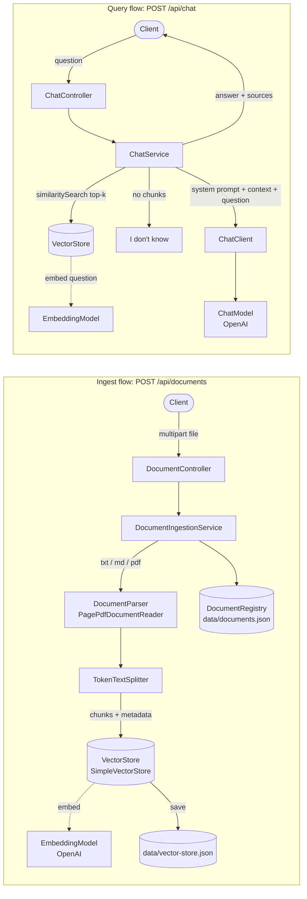
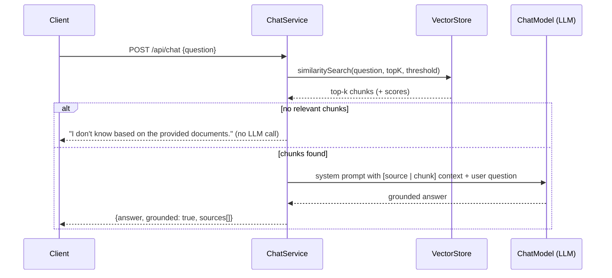

# Spring AI RAG Chatbot

[](https://github.com/anantghadifreelance/spring-ai-rag-chatbot/actions/workflows/ci.yml)


A **Retrieval-Augmented Generation (RAG)** document Q&A API built with **Spring Boot** and **Spring AI 1.0 GA**.
Upload `.txt`, `.md` or `.pdf` files, and ask questions that are answered **only** from those documents. Every
answer comes back with the source file names and chunk ids it was grounded on. When the documents don't
contain the answer, the bot says *"I don't know"* instead of making something up.

## Features

- **Document ingestion**: multipart upload of `.txt`, `.md`/`.markdown` and `.pdf` (Spring AI PDF reader / Apache PDFBox)
- **Token-aware chunking** with Spring AI's `TokenTextSplitter` (chunk size and limits configurable)
- **Embeddings + vector search** through the portable `EmbeddingModel` and `VectorStore` abstractions
- **Zero-infrastructure default**: `SimpleVectorStore` persisted to a local JSON file, so data survives restarts
- **Grounded answers** via `ChatClient` and a strict system prompt (`prompts/rag-system.st`) that refuses to guess
- **Source citations**: each answer lists document id, file name, chunk id and similarity score
- **No-context short-circuit**: if retrieval finds nothing relevant, the LLM is never called (no cost, no hallucination)
- **Document management**: list, inspect and delete documents; delete removes their chunks from the vector store
- **Deterministic chunk ids** (UUIDs derived from document id + chunk index), compatible with pgvector
- **RFC 9457 `ProblemDetail`** errors from a global exception handler (400/404/413/415/422/502)
- **Offline test suite**: runs with no API key, using a hashed bag-of-words embedding model and a recording chat model

## Tech stack

| Area | Technology |
|------|------------|
| Language | Java 17 |
| Framework | Spring Boot 3.4 (Web, Validation, Actuator) |
| AI | Spring AI 1.0 GA: `ChatClient`, `EmbeddingModel`, `VectorStore`, `TokenTextSplitter`, `PagePdfDocumentReader` |
| LLM provider | OpenAI (`gpt-4o-mini` chat, `text-embedding-3-small` embeddings), swappable |
| Vector store | `SimpleVectorStore` (JSON file). PostgreSQL + pgvector as an option |
| Testing | JUnit 5, Mockito, AssertJ, Spring MockMvc, PDFBox (generated test PDFs) |
| Build / CI | Maven, GitHub Actions |

## Architecture





## Project structure

```text
spring-ai-rag-chatbot
├── .github/workflows/ci.yml
├── samples/
│   └── spring-boot-interview-faq.md        # sample document to upload
├── src/main/java/com/anantghadi/ragchatbot
│   ├── RagChatbotApplication.java
│   ├── chat/
│   │   ├── ChatController.java             # POST /api/chat
│   │   ├── ChatService.java                # retrieve -> prompt -> answer
│   │   ├── ChatRequest.java                # record + validation
│   │   ├── ChatAnswer.java                 # record
│   │   └── SourceReference.java            # record
│   ├── config/
│   │   ├── AiConfig.java                   # ChatClient + TokenTextSplitter beans
│   │   ├── ClockConfig.java
│   │   ├── RagProperties.java              # rag.* type-safe settings
│   │   ├── VectorStoreConfig.java          # SimpleVectorStore + JSON persistence
│   │   └── VectorStorePersistence.java
│   ├── document/
│   │   ├── DocumentController.java         # /api/documents CRUD
│   │   ├── DocumentIngestionService.java   # read -> split -> embed -> store
│   │   ├── DocumentParser.java             # txt/md/pdf -> Spring AI Documents
│   │   ├── DocumentRegistry.java           # catalogue of ingested docs (JSON)
│   │   ├── DocumentType.java
│   │   ├── DocumentMetadata.java
│   │   ├── IngestedDocument.java / DocumentResponse.java
│   │   └── *Exception.java
│   └── web/
│       └── GlobalExceptionHandler.java     # ProblemDetail responses
├── src/main/resources
│   ├── application.yml
│   └── prompts/rag-system.st               # grounded system prompt
└── src/test/java/com/anantghadi/ragchatbot
    ├── RagChatbotApplicationIntegrationTest.java   # full flow, no API key
    ├── chat/      ChatServiceTest, ChatControllerTest
    ├── document/  DocumentIngestionServiceTest, DocumentRegistryTest,
    │              DocumentControllerTest, DocumentTypeTest
    └── support/   HashingEmbeddingModel, RecordingChatModel, OfflineAiTestConfiguration
```

## Getting started

### Prerequisites

- Java 17+
- Maven 3.9+
- An OpenAI API key, only for running the app (the build and tests don't need one)

### Run

```bash
git clone https://github.com/anantghadifreelance/spring-ai-rag-chatbot.git
cd spring-ai-rag-chatbot

export OPENAI_API_KEY=sk-...
mvn spring-boot:run
```

The API starts on `http://localhost:8080`. Vectors and the document catalogue are written to `./data/`.

### Build and test

```bash
mvn -B verify      # compiles and runs all tests offline, no API key required
```

### Configuration

| Property | Default | Description |
|----------|---------|-------------|
| `OPENAI_API_KEY` (env) | none | OpenAI key used for chat and embeddings |
| `spring.ai.openai.chat.options.model` | `gpt-4o-mini` | Chat model |
| `spring.ai.openai.embedding.options.model` | `text-embedding-3-small` | Embedding model |
| `rag.vector-store.type` | `simple` | `simple` = local JSON-backed store; any other value disables it (for example `pgvector`) |
| `rag.storage.vector-store-file` | `data/vector-store.json` | SimpleVectorStore snapshot |
| `rag.storage.registry-file` | `data/documents.json` | Ingested document catalogue |
| `rag.chunking.chunk-size` | `400` | Target tokens per chunk |
| `rag.retrieval.top-k` | `4` | Chunks retrieved per question (overridable per request, 1 to 20) |
| `rag.retrieval.similarity-threshold` | `0.5` | Minimum cosine similarity for a chunk to count as context |
| `spring.servlet.multipart.max-file-size` | `10MB` | Upload size limit |

## API

| Method | Endpoint | Description | Success |
|--------|----------|-------------|---------|
| `POST` | `/api/documents` | Upload and ingest a `.txt` / `.md` / `.pdf` file (multipart field `file`) | `201 Created` + `Location` |
| `GET` | `/api/documents` | List ingested documents (newest first) | `200 OK` |
| `GET` | `/api/documents/{id}` | Get one document with its chunk ids | `200 OK` |
| `DELETE` | `/api/documents/{id}` | Delete a document and all of its chunks | `204 No Content` |
| `POST` | `/api/chat` | Ask a question: `{"question": "...", "topK": 4}` (`topK` optional) | `200 OK` |
| `GET` | `/actuator/health` | Health check | `200 OK` |

### Error responses (`application/problem+json`)

| Status | When |
|--------|------|
| `400` | Blank/oversized question, `topK` out of range, missing `file` part, empty file |
| `404` | Unknown document id |
| `413` | Upload larger than the configured limit |
| `415` | Unsupported file extension |
| `422` | File could not be parsed or contains no extractable text |
| `502` | The LLM or embedding provider failed (bad key, rate limit, outage) |

### curl examples

Upload the sample FAQ:

```bash
curl -s -F "file=@samples/spring-boot-interview-faq.md" http://localhost:8080/api/documents
```

```json
{
  "id": "9d7c1f8e-4b1a-4a57-9a0e-2a6b8f3c1d22",
  "filename": "spring-boot-interview-faq.md",
  "contentType": "text/markdown",
  "sizeBytes": 4310,
  "chunkCount": 3,
  "chunkIds": ["5f0c...", "a41e...", "c9b2..."],
  "ingestedAt": "2026-11-01T10:15:30Z"
}
```

Ask a question:

```bash
curl -s http://localhost:8080/api/chat \
  -H "Content-Type: application/json" \
  -d '{"question": "How does Spring Boot auto-configuration work?"}'
```

```json
{
  "answer": "Auto-configuration classes are listed in META-INF/spring/...AutoConfiguration.imports and guarded by conditions such as @ConditionalOnClass, @ConditionalOnMissingBean and @ConditionalOnProperty. (spring-boot-interview-faq.md)",
  "grounded": true,
  "sources": [
    {
      "documentId": "9d7c1f8e-4b1a-4a57-9a0e-2a6b8f3c1d22",
      "filename": "spring-boot-interview-faq.md",
      "chunkId": "5f0c...",
      "score": 0.83
    }
  ]
}
```

Ask something the documents don't cover:

```bash
curl -s http://localhost:8080/api/chat \
  -H "Content-Type: application/json" \
  -d '{"question": "Who won the 2010 FIFA World Cup?"}'
# {"answer":"I don't know based on the provided documents.","grounded":false,"sources":[]}
```

List and delete documents:

```bash
curl -s http://localhost:8080/api/documents
curl -i -X DELETE http://localhost:8080/api/documents/9d7c1f8e-4b1a-4a57-9a0e-2a6b8f3c1d22
```

## Using pgvector instead of the local store

`SimpleVectorStore` is ideal for demos and small corpora. For production, switch to PostgreSQL + pgvector.
The application code only depends on the `VectorStore` interface, so no Java changes are needed:

1. Add the starter (version managed by the Spring AI BOM):

   ```xml
   <dependency>
       <groupId>org.springframework.ai</groupId>
       <artifactId>spring-ai-starter-vector-store-pgvector</artifactId>
   </dependency>
   ```

2. Run Postgres with the extension:

   ```bash
   docker run -d --name pgvector -p 5432:5432 \
     -e POSTGRES_USER=rag -e POSTGRES_PASSWORD=rag -e POSTGRES_DB=rag pgvector/pgvector:pg16
   ```

3. Configure it (for example in an `application-pgvector.yml`):

   ```yaml
   spring:
     datasource:
       url: jdbc:postgresql://localhost:5432/rag
       username: rag
       password: rag
     ai:
       vectorstore:
         pgvector:
           initialize-schema: true
           index-type: HNSW
           distance-type: COSINE_DISTANCE
           dimensions: 1536   # text-embedding-3-small
   rag:
     vector-store:
       type: pgvector       # switches off the SimpleVectorStore bean
   ```

`VectorStorePersistence` becomes a no-op automatically, because Postgres persists the vectors itself. Chunk ids are
already UUIDs, which pgvector requires. For a multi-instance deployment, also move the `DocumentRegistry` into a
database table.

## Design notes

- **Retrieval is explicit, not hidden in an advisor.** Spring AI's `QuestionAnswerAdvisor` is convenient, but doing
  the `similaritySearch` in `ChatService` makes it possible to (1) skip the LLM call entirely when nothing
  relevant is found, (2) return precise source citations with scores, and (3) unit-test retrieval and prompting
  separately.
- **Grounding prompt lives in a template file** (`prompts/rag-system.st`). Retrieved chunks are injected as a
  template *parameter*, so code snippets with `{braces}` inside documents can't break prompt rendering. Each chunk
  is labelled `[source: file | chunk: id]` so the model can cite it.
- **Temperature 0** for factual, repeatable answers.
- **Embedding happens inside `VectorStore.add`.** The ingestion service stays provider-agnostic: swapping OpenAI
  for Ollama, Azure OpenAI or Bedrock is a dependency and property change.
- **Chunk metadata** (`document_id`, `source`, `content_type`, `chunk_index`, plus `page_number` for PDFs) travels
  with every vector, which makes citations and deletes straightforward.
- **Deterministic chunk ids** (`UUID.nameUUIDFromBytes(documentId + ":" + index)`) keep ids stable and traceable.
- **Persistence is a strategy** (`VectorStorePersistence`): a JSON snapshot for `SimpleVectorStore`, a no-op for
  server-backed stores. Writes to the store are serialised so snapshots stay consistent.
- **Filenames are sanitised** (client-supplied paths stripped) and uploads are validated by extension, emptiness
  and size before any embedding cost is incurred.
- **Tests never touch the network.** The `test` profile disables the OpenAI auto-configuration
  (`spring.ai.model.chat=none`, `spring.ai.model.embedding=none`) and plugs in a deterministic hashed
  bag-of-words `EmbeddingModel` and a recording `ChatModel`, so the full ingest, retrieve, answer and delete
  flow runs against a real `SimpleVectorStore` in CI.

## Roadmap

- Streaming answers (`ChatClient.stream()` with Server-Sent Events)
- Conversation memory (`MessageChatMemoryAdvisor`) for follow-up questions
- Metadata filtering (ask within one document) using `SearchRequest.filterExpression`
- Hybrid search (BM25 + vectors) and re-ranking

## Author

**Anant Ghadi**, Senior Java Full Stack Developer (Spring Boot, microservices, Spring AI, LLMs and RAG)

- LinkedIn: [linkedin.com/in/anantghadi](https://www.linkedin.com/in/anantghadi/)
- Topmate: [topmate.io/anantghadi](https://topmate.io/anantghadi)
- Dev.to: [dev.to/anantghadi](https://dev.to/anantghadi)

> 💼 Available for freelance work: I build production-ready Spring Boot backends and Spring AI / RAG integrations. Reach out on [LinkedIn](https://www.linkedin.com/in/anantghadi/) or book a call on [Topmate](https://topmate.io/anantghadi).

## License

Released under the [MIT License](LICENSE). © 2026 Anant Ghadi
